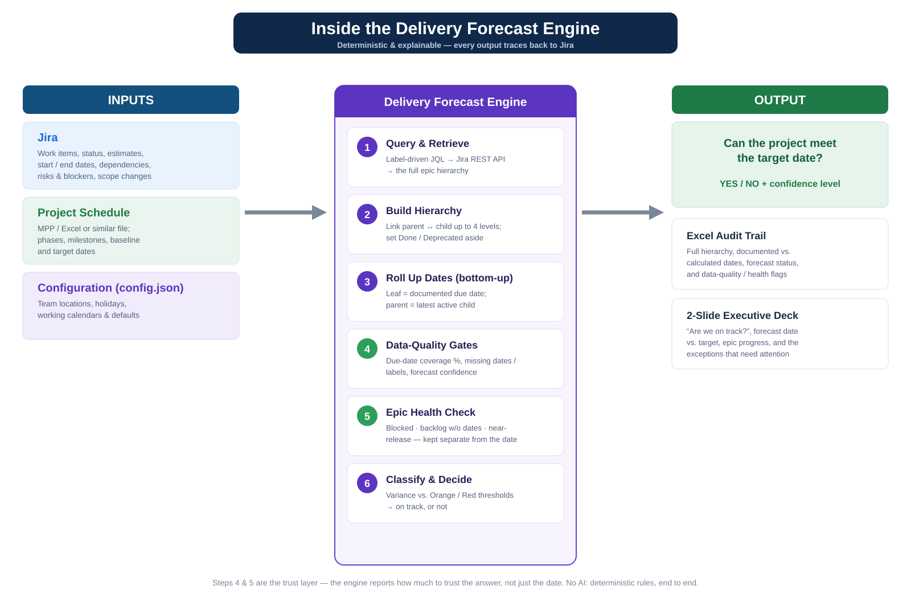

# Project Intelligence

### From work-item data to program-level delivery intelligence

**Are we going to make the date?**

Large programs generate enormous amounts of work-item data. Turning that
data into a reliable delivery forecast still requires significant manual
effort.

Project Intelligence is a program-level delivery analytics solution
that combines work-item data from systems such as Jira with external
program schedules and context—including program start and end dates,
milestones, team assignments, global locations, working calendars, and
holidays.

**Project Intelligence goes beyond displaying project status. It analyzes
work-item data and program context to surface delivery risks, data gaps,
and forecast insights that may otherwise remain hidden across teams.**

*The current foundation is data integration, data engineering,
deterministic calculations, and configurable business rules. Future
exploration may include descriptive and predictive analytics,
machine learning, and AI-assisted insights, guided by data availability
and demonstrated business value.*

## What it does

  -----------------------------------------------------------------------
  Capability                          What it answers
  ----------------------------------- -----------------------------------
  **Delivery forecasting**            Are we likely to meet the target
                                      date?

  **Data quality & planning           Can we trust the work-item data?
  integrity**

  **Epic health**                     What active work, blockers, or
                                      planning gaps need attention?
  -----------------------------------------------------------------------

**Data quality is part of the answer---not an afterthought.**

A parent marked Done while its children remain active, missing or
overdue due dates, and inconsistent status/date information can distort
a forecast. Project Intelligence surfaces these issues rather than
blindly trusting the hierarchy.

## How it works

Project Intelligence combines two sources:

-   **Work management system (currently Jira):** work items, hierarchy,
    status, ownership, and due dates.
-   **External program configuration:** program start and end dates,
    milestones, team assignments, global locations, working calendars,
    holidays, availability, and forecasting parameters.

The deterministic engine validates the data, applies configurable
business rules, and produces explainable program-level insights.

## What it produces today

-   **Excel audit trail:** work-item hierarchy, documented and
    calculated dates, forecast status, and data-quality findings.
-   **Executive PowerPoint:** program forecast, target-date comparison,
    Epic health, and exceptions requiring attention.

## Why deterministic first?

Start with transparent, testable business rules. Explore AI/ML only when
sufficient historical data is available and when those methods can
demonstrate value beyond the deterministic baseline.

See [Business Rules](./BUSINESS_RULES.md) for the current forecasting
and Epic-health rules.

## Capability roadmap

  Capability                           Status
  ------------------------------------ ---------
  Jira integration and core forecast   Built
  Data-quality checks                  Built
  Team and location mapping            Built
  Calendar adjustments                 Partial
  Dependency and capacity awareness    Planned
  Predictive delivery intelligence     Future

## Dependencies & limitations

Project Intelligence depends on the availability, completeness,
accuracy, and consistency of data from its connected sources.

- **Work management data:** Jira is the current source for work items,
  hierarchy, status, ownership, and due dates. Data quality and team
  practices can vary, affecting the reliability of downstream analysis.
- **External program context:** Program schedules, milestones, team
  assignments, global locations, working calendars, holidays, and
  forecasting parameters are maintained separately. These inputs must
  be kept aligned with actual program conditions.
- **Integration reliability:** API availability, access permissions,
  rate limits, synchronization delays, and changes to source-system
  APIs or data models can affect data ingestion and processing.
- **Platform dependency:** The current implementation is designed
  around Jira's data model. Supporting other work management systems
  will require additional connectors, data mapping, and validation.

**Design principle:** Project Intelligence should not blindly assume
that source data is complete or authoritative. It should validate
available information, surface gaps and inconsistencies, communicate
limitations, and make the basis of its forecasts transparent.

The system should distinguish between a project that is genuinely
healthy, one that appears healthy because its underlying data is
incomplete, and one whose health cannot be reliably assessed because
the available evidence is insufficient. In the latter case, it should
report **"Insufficient data to assess"** rather than produce a
misleading forecast.

------------------------------------------------------------------------

**Project Intelligence doesn't replace the systems that manage the work
and program schedule. It makes information from those sources more
useful for program-level decisions.**
