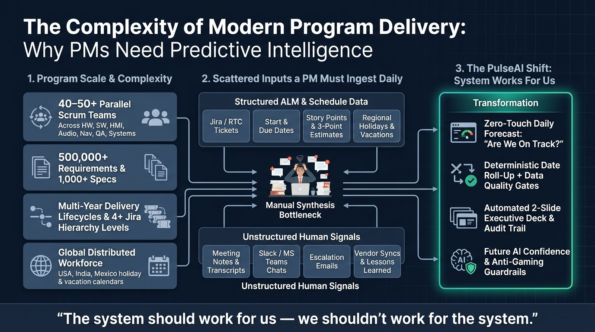
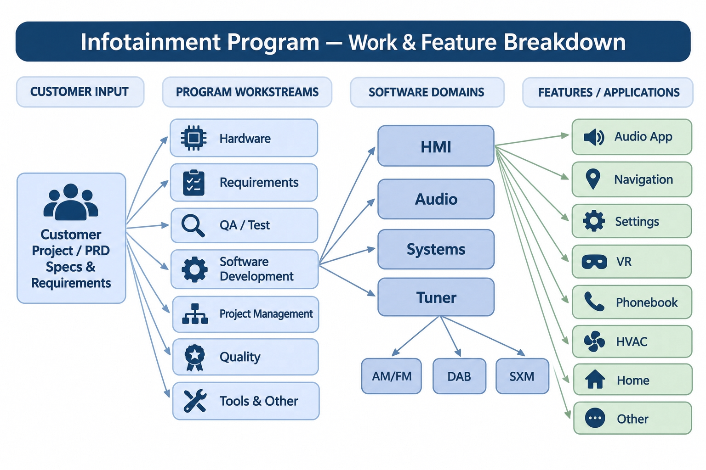
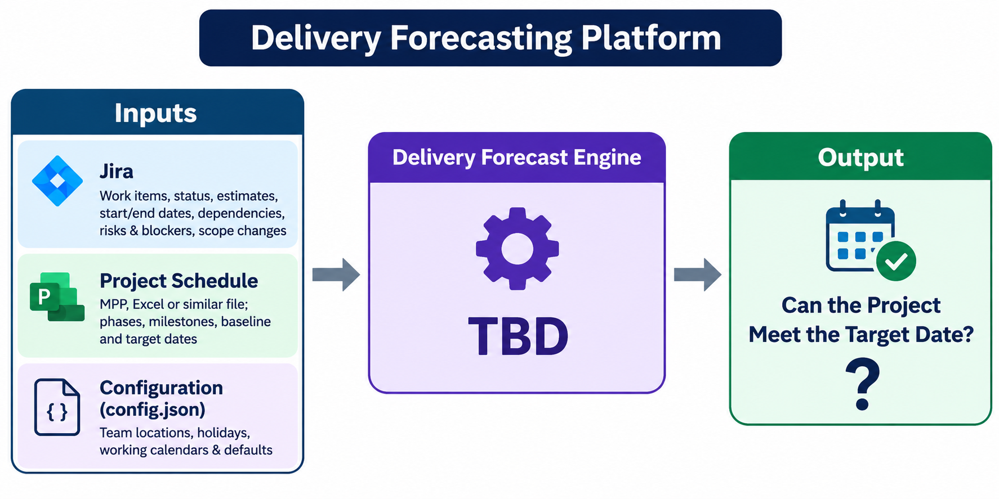

# Project Intelligence

### A Delivery Forecasting Platform for Complex Programs

> *"The system should work for us — we shouldn't work for the system."*

**What this is:** A deterministic, explainable engine that answers one deceptively simple question for a large, multi-team program — **"Can we still meet our target date?"** — and shows its work, every time.

**What it is *not* (yet):** An AI product. Version 1 is intentionally rules-based and fully auditable. AI is the *destination* (the platform's north star, **PulseAI**), not the starting point — and this README explains exactly why.

---

## The Problem: One Question, an Impossible Amount of Data

A program manager on a modern software program is asked a simple question in every status meeting:

> *"Are we going to make the date?"*

Answering it honestly means a single person manually digesting an overwhelming, scattered pile of data — and then applying a stack of rules in their head — **over and over, every time anything changes.**

### 1. The scale a PM must hold in their head

A representative large automotive program looks like this:

- **40–50+ parallel Scrum teams** across HW, SW, HMI, Audio, Navigation, QA, and Systems
- **500,000+ requirements** and **1,000+ specifications**
- **Multi-year delivery lifecycles** across **4+ levels** of Jira hierarchy (Epic → Story → Task → Sub-task)
- A **globally distributed workforce** — USA, India, Mexico — each with its own holiday and vacation calendars

### 2. The scattered inputs a PM must ingest — daily

| Structured | Unstructured |
|---|---|
| Jira / RTC tickets | Meeting notes & transcripts |
| Start & due dates | Slack / MS Teams chats |
| Story points & 3-point estimates | Escalation emails |
| Regional holidays & vacations | Vendor syncs & lessons learned |

All of it converges on one human being: the **manual synthesis bottleneck.**

### 3. The hidden tax: this isn't a one-time calculation

The current-state reality, step by step:

1. **Project starts** — the PM confirms label, start date, target date, teams. *(Data standards often aren't enforced yet.)*
2. **Work is structured** — teams create Epics/Stories/Tasks/Sub-tasks. *(Missing labels, dates, estimates, or assignees quietly weaken the forecast.)*
3. **Inputs are collected** — the PM chases dates, dependencies, vacation schedules, holiday calendars. *(Jira doesn't hold availability data — the PM gathers it separately, and omissions change the answer.)*
4. **Forecast is built** — the PM traverses the hierarchy, rolls up the latest child dates, consolidates in Excel. *(Manual formulas, repeated by hand.)*
5. **Date is assessed** — the PM compares the calculated date to the committed target. *(The answer is stale the moment Jira changes.)*

**This is the headache.** Skilled program leaders spend their time as data-entry clerks and spreadsheet mechanics instead of as strategic leaders — and the answer they produce is out of date before the meeting ends.

---

## The Rules Behind the Answer

"Can we make the date?" isn't one calculation — it's a **governed set of rules** a good PM applies consistently (and that most tools don't encode). This platform makes those rules explicit, numbered, and testable. A few examples:

- **Exclude Done and Deprecated work** from the forecast, but keep them visible for traceability *(BR-01)*
- **Roll up the latest active-child date** — a parent can't finish before its last active child *(BR-03)*
- **Require minimum due-date coverage** — below the threshold, say *"Insufficient Data,"* don't fake a forecast *(BR-08, BR-13)*
- **Flag a "Done" Epic that still has active children** as a data issue, not a green light *(BR-04)*

> The full register — **17 forecast rules + 9 Epic-health rules** — lives in [**Business Rules**](./BUSINESS_RULES.md).

This is the core thesis: **before you can predict project health, you need a trustworthy, explainable definition of what "on track" even means.** This engine *is* that definition.

---

## Beyond the Date: Epic Health

A delivery date alone doesn't help a PM *act*. The next question is always *"…so what's putting it at risk?"* — and the platform answers that too, as a **separate, factual layer** that never silently alters the forecast.

For every open Epic, the engine reports:

- **Blocked** active descendants
- **Backlog** items with **no due date** (the silent forecast-killers)
- **Backlog near release** — backlog work when the Epic/project date is inside the warning window
- **Other active statuses** — surfaced, not ignored, so nothing hides

Two deliberate design rules keep it trustworthy:

- **Health is kept separate from the forecast** — it explains delivery conditions but does **not** change the date or variance *(EH-07)*.
- **Facts before scores** — it reports counts and an *"Attention Required"* message; it does **not** invent a numeric health score or a fake Red/Orange rating *(EH-08)*.

> The result: a PM doesn't just learn *whether* the date is at risk — they see *exactly which Epics, and why*, traceable to the ticket.

---

## How It Works

From three inputs — Jira, an optional project schedule, and a configuration file — the engine runs a fixed, six-step deterministic pipeline and ends with one decision: **can the project meet its target date?**

Steps 4 and 5 are the **trust layer**: the engine reports *how much confidence* to place in the answer — not just a date. There is no AI in this path; it is rules and math, end to end.

---

## Why Deterministic First — and Why That's a Feature

A fair question: *"Isn't this an AI project?"* Eventually. Not yet — and that's a deliberate design decision.

| Now — Deterministic (MVP 1–7) | Later — AI / ML (MVP 8+) |
|---|---|
| Hierarchy traversal & recursive date roll-up | Learn planned-vs-actual delivery patterns |
| Required-field & data-quality validation | Estimate the *probability* of hitting a date |
| Working-day & regional-holiday math | Detect recurring delay / risk signals |
| Dependency, status & capacity rules | Compare team / work-type reliability over time |
| **Explainable outputs that trace back to Jira** | **Requires sufficient, clean historical data** |

**Decision principle:** *Do not use AI where deterministic logic is sufficient. Add AI only when it materially improves forecast accuracy or decision quality — and only once there is clean historical data to learn from.*

The deterministic engine isn't a stopgap. It's the **ground truth and the labeled data** a future predictive layer will learn from.

---

## Capability Roadmap

Sequencing is intentional; each phase adds one bounded capability and a usable PM decision artifact before the next is added.

| Phase | Capability | Status |
|---|---|---|
| **Phase 0** | Foundation — connect to Jira, label-driven query, config | ✅ Built |
| **MVP 1** | Core Forecast — hierarchy extraction, recursive roll-up, target-date decision | ✅ Built |
| **MVP 2** | Data Quality — detect missing dates, labels, assignees, broken links | ✅ Built |
| **MVP 3** | Team & Location — map assignees to locations / calendar groups | ✅ Built |
| **MVP 4** | Calendar Awareness — apply regional holidays & vacation to working-day math | 🚧 Partial (holiday *warnings* live; working-day adjustment next) |
| **MVP 5** | Dependency Awareness — sequential & cross-team dependencies, critical path | ⬜ Planned |
| **MVP 6** | Execution Awareness — use status & active work to refine confidence | 🚧 Partial (status rules & confidence live) |
| **MVP 7** | Capacity Awareness — workload & resource constraints | ⬜ Planned |
| **MVP 8** | Delivery Intelligence — historical patterns, predictive risk *(the AI layer)* | ⬜ Future |

**You are here → MVP 3 complete, MVP 4 & 6 in progress.**

Progression: **trusted data → explainable forecast → context-aware forecast → delivery intelligence.**

---

## What It Produces Today

From a single run against Jira, with zero manual assembly:

- **A color-coded Excel audit trail** — the full hierarchy, documented vs. calculated dates, forecast status, data-quality flags, and Epic-health signals.
- **A 2-slide executive deck** — "Are we on track?", forecast date vs. target, Epic progress, and the exceptions that need attention.

The same answer a PM spends hours assembling by hand — regenerated on demand, traceable to the exact ticket.

---

## How This Differs From Jira & Existing Tools

This is **not** trying to out-schedule Jira. It's the **last-mile trust-and-hygiene layer** on top of it.

- **Jira Advanced Roadmaps** rolls up dates — but uses earliest-start/latest-end and *breaks silently when child dates are missing*. This engine excludes Done/Deprecated work, requires coverage, and tells you how much to trust the result.
- **Hygiene apps** (e.g. Rollup Guard) check ~3 hierarchy mismatches. This engine applies **26 governed rules** plus coverage %, confidence, and holiday-awareness.
- **Exec-deck tools** (e.g. StatusDeck) export *sprint* decks. This works at **program level**, deterministically, with a full audit trail beside the deck.

**Where Jira is genuinely ahead (and on our roadmap, not our claims):** capacity-based auto-scheduling and dependency handling — our MVP 5 and MVP 7, not yet built.

---

## What's in This Repo

| File | Purpose |
|---|---|
| `README.md` | This overview — the problem, the rules, the roadmap |
| `BUSINESS_RULES.md` | The 26-rule register (17 forecast + 9 Epic-health) |
| `images/` | Diagrams |
| `code/` | The deterministic forecasting engine *(coming soon)* |

*The engine, a sanitized configuration template, and the full design deck (journey, HLD/LLD, roadmap) will be added to `code/` as the repository is built out.*

---

*Built from real program-delivery experience — where the question is always "Can we make the date?", and the honest answer requires more than a spreadsheet and a prayer.*
