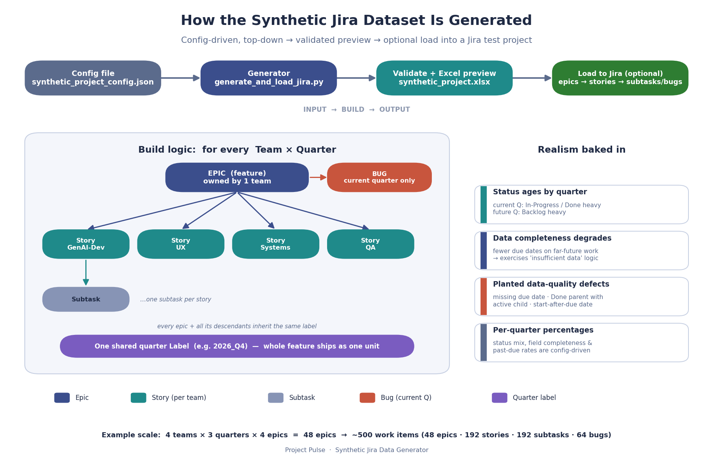

## Synthetic Jira Data Generator

The Synthetic Jira Data Generator creates realistic project data
based on configurable project scenarios. It provides a controlled
dataset for evaluating Project Pulse's forecasting capabilities
and validating its automation workflows.



### How It Works

The generator uses a configuration file to define the project
scenario, including:

- **Project Timeline:** Start date, end date, and milestones.
- **Team & Delivery Context:** Team names and countries.
- **Work Structure:** Epics, stories, bugs, and subtasks.
- **Project Data Characteristics:** Status distribution, field
  completeness, and past-due percentages.
- **Test Scenarios:** Missing fields, inconsistent dates, and
  parent-child data inconsistencies.

Based on these inputs, the generator creates synthetic project
data, including work items, delivery attributes, and dependencies.

The generated data is available as an Excel preview with a
validation summary. It can also optionally be loaded into a
Jira test project.

### How to Run

1. **Configure** — copy `synthetic_project_config.example.json` to
   `synthetic_project_config.json` and edit teams, quarters, ticket counts,
   and status mix. To load into Jira, fill in `base_url`, `email`,
   `api_token`, and `project_key`, then set `output.load_to_jira: true`.
   For an Excel-only dry run, leave `load_to_jira: false`.
2. **Run** — the script reads the config next to it, no arguments:

   ```bash
   python generate_and_load_jira.py
   ```

**Input**

- `synthetic_project_config.json` — the single source of truth: project
  timeline, teams, quarters/labels, per-quarter status and field-completeness
  percentages, planted test-case defects, and output switches.

**Output**

- `synthetic_project.xlsx` — a preview workbook of every generated work item
  with a validation summary (always produced when `generate_excel: true`).
- **Jira issues** — when `load_to_jira: true`, the full hierarchy
  (epics → stories → subtasks/bugs, with labels and teams) is created in the
  configured Jira project.
- `jira_created_items.json` — map of synthetic ID → created Jira key.
- `jira_failed_items.json` — any items that failed, with the reason.

> **Security:** `synthetic_project_config.json` holds a real Jira API token and
> is **git-ignored** — never commit it. The committed template is
> `synthetic_project_config.example.json`, which must carry a placeholder token
> (`PASTE_API_TOKEN`), not a real key.

### Why It Matters

This controlled test data helps evaluate Project Pulse's
forecasting logic, assess how it handles different project
conditions, and verify that automated workflows behave as expected.

### Dataset Design — Example: "Infotainment Platform Program"

The example scenario (`synthetic_project_config.json`) models a realistic
multi-team automotive infotainment program **mid-flight**, so the forecaster
has genuine work to forecast — not a toy tree.

**Program shape**

- **Teams (components):** `GenAI-Dev`, `UX`, `Systems`, `QA` — the groups that
  collaborate on every deliverable.
- **Epics = features:** each epic is a deliverable feature, owned by **one** team.
- **Cross-functional stories:** every epic has **one story per team**
  (GenAI-Dev, UX, Systems, QA) — so each feature reflects real matrixed
  delivery: one accountable owner, every team contributing a piece.
- **Subtasks:** one per story (the unit of individual work).
- **Bugs:** created **only on epics in the current, actively-developed quarter** —
  because bugs come from code that already exists, not from unbuilt future work.

**Timeline & scope**

- The program runs in 3-month quarters (e.g., `2026_Q4`, `2027_Q1`, `2027_Q2`).
- A **snapshot date** sets "today," so the data shows a program mid-delivery: the
  current quarter in progress, later quarters planned.
- Epics are planned **per quarter** — this *is* the roadmap/scope (N epics per
  team per quarter). Later quarters are added as scope firms up.

**Labels — full-delivery units**

- Every epic and **all of its descendants** (stories, subtasks, bugs) carry the
  **same quarter label** (e.g., `2027_Q1`), so a whole feature ships as one
  labeled unit. The forecaster can then slice the program by any quarter, or pull
  several quarters at once.

**Realism baked in (so the forecaster has something to catch)**

- **Status aging:** the current quarter is In-Progress/Done heavy; later quarters
  are Backlog heavy.
- **Data completeness degrades** for further-out work (fewer due dates on future
  quarters) — which exercises the forecaster's "insufficient data" logic.
- **Past-due**, **blocked**, and planted **data-quality issues** (a missing due
  date, a Done parent with an active child, an impossible start-after-due date)
  give the forecast real risks to surface.

**Example scale:** 4 teams × 3 quarters × 4 epics per team = 48 epics → **~500
work items** (48 epics · 192 stories · 192 subtasks · 64 bugs).
